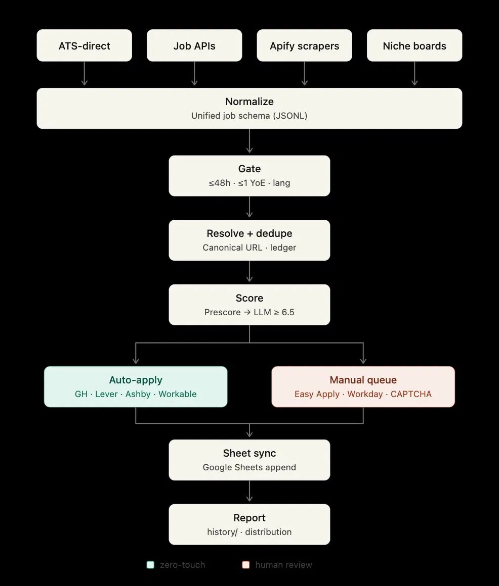

# JobPilot — Autopilot for Job Applications

An open-source, self-hosted job-search pipeline that **discovers**, **scores**, and **auto-applies** to early-career software engineering roles — all from your own machine, with your own data.

```
discover → normalize → gate → dedupe → score → review → apply → sync → report
```



---

## Why JobPilot?

Job searching at scale is repetitive, error-prone, and time-consuming. JobPilot turns that process into a structured, auditable pipeline:

- Pulls from **multiple job boards and ATS APIs** in one run
- Filters by recency, seniority, location, and tech stack match
- Scores each role against your candidate profile using an **LLM rubric**
- Stops for **human review** before touching any submit button
- Auto-fills and submits forms on supported ATS platforms via **Playwright**
- Writes everything to a **Google Sheet** for a clean application ledger

Every decision is logged. Every skipped job has a reason. Nothing is invented.

---

## Tech Stack

| Layer | Tools |
|---|---|
| Language | Python 3.12+ |
| Browser automation | Playwright (Chromium) |
| LLM scoring & Q&A | Anthropic Claude (Haiku for fast scoring, configurable) |
| Job discovery | ATS APIs, Apify scrapers, HTTP adapters |
| Persistence | SQLite ledger + Google Sheets |
| Config | YAML + `.env` |

---

## Pipeline Stages

### 1. Discover
Fetch fresh jobs from configured sources. ATS-direct sources (Greenhouse, Lever, Ashby) are preferred — cleaner metadata, real timestamps, canonical application URLs.

### 2. Normalize
All incoming jobs are converted into a unified `Job` schema (`src/models.py`). Fields include: company, title, location, remote policy, seniority, posting timestamp, ATS provider, tech stack, visa/relocation signals.

### 3. Gate
Fast rule-based pre-filter before any LLM call. Configurable per run:
- Freshness window (`freshness:` — 30 days on the first run, then time since the last run clamped to 72h–7d; `--window 24h|72h|7d|30d` overrides)
- Role families A/B/C (`search.families` — AI/ML, software, adjacent/forward-deployed)
- Max experience requirement (`gate.max_yoe`, default 2)
- Language requirements
- Target countries / remote policies (geography tiers in `search.markets`)

### 4. Dedupe
Canonical ATS URLs are resolved and checked against the SQLite ledger. Already-applied or already-seen jobs are skipped.

### 5. Score, sponsorship & verification
Each gated job is scored 0–100 against `CANDIDATE.md` + the matching resume (tech 30%, experience 25%, seniority/education 20%, career alignment 15%, language/location 10%) → Strong 80+ / Good 65–79 / Stretch 50–64 / Not recommended. The scorer also returns matching skills, missing mandatory/preferred qualifications, the resume to use (AI or SWE), the project to emphasize, positioning advice, risks, and any hard blocker.

Visa sponsorship is classified **separately** (`src/sponsorship.py`): **A** explicit in the posting (quoted), **B** company-level evidence (gov.uk sponsor register, SponsorMap, Applywave, UKHired/Relocate.me/Landed listing), **C** unknown, **D** restricted (no sponsorship, existing work rights, citizenship, clearance). An LLM-claimed A/D is accepted only if its quote is verbatim in the posting. Australian roles also get offshore eligibility, the subclass 482 pathway and salary-vs-CSIT eligibility. Hard blockers and D-category onsite roles are excluded before ranking.

Survivors are verified (`src/verify.py`): ATS-API jobs count as open, other apply pages are fetched and closed listings dropped; login-walled boards are labelled "unverified". Review threshold: `score.threshold` (65).

### 6. Review (human in the loop)
In `review_first` mode, the pipeline **stops** after scoring and writes a review file to `manual_queue/`. You approve specific jobs before anything is submitted.

In `full_auto` mode, jobs on supported ATS platforms are submitted automatically. Unsupported or blocked jobs are listed at the end as manual applications.

### 7. Apply
Playwright fills and submits forms on supported ATS platforms:

| ATS | Status |
|---|---|
| Greenhouse | Supported |
| Ashby | Supported |
| Lever | Supported |
| Workable | Supported |
| LinkedIn Easy Apply | Manual queue only |
| Workday | Manual queue only |
| CAPTCHA-protected | Manual queue only |

If the filler hits a field it cannot complete, it raises `NeedsUserInput` and routes the job to the manual-required list. Unknown dropdown fallback can be controlled with `apply.allow_select_fallback`.

### 8. Sync, tracker & report
Applied and queued jobs are written to Google Sheets. Every eligible job goes into the tracker (`src/tracker.py`, SQLite), which reports new / still open / closed / changed / newly-sponsored jobs between runs — `jobpilot --tracker md|csv|json` prints it, `--set-status <job_id>=Interview` updates it. The full report (Sections A–G: resume assessment, best matches, sponsorship opportunities, newly published by 24h/72h/7d, by career path, top 10 with reasons, coverage & limitations incl. Apify spend) prints to the terminal and is saved to `history/`.

Apify spend is capped per session (`apify_budget_usd`, $5): each actor's request is sized from its per-result price and budget share, every run carries `maxTotalChargeUsd`, and going past the cap needs an interactive approval or `--apify-budget`.

---

## Quickstart

### Prerequisites

- Python 3.12+
- A Playwright-compatible system (macOS, Linux, Windows WSL2)
- An [Anthropic API key](https://console.anthropic.com/)
- A Google Cloud service account with Sheets API access (optional, for sheet sync)

### Setup

```bash
git clone https://github.com/your-username/jobpilot-autopilot-for-job-applications.git
cd jobpilot-autopilot-for-job-applications

python -m venv .venv
source .venv/bin/activate

pip install -r requirements.txt
playwright install chromium
```

### Configure

Copy the example files and fill in your details:

```bash
cp CANDIDATE.EXAMPLE.md CANDIDATE.md
cp .env.example .env
```

`CANDIDATE.md` is your single source of truth. The pipeline answers forms **only** from this file — no data is invented. See [`CANDIDATE.EXAMPLE.md`](CANDIDATE.EXAMPLE.md) for the full schema.

Your `.env` needs at minimum:

```env
ANTHROPIC_API_KEY=sk-ant-...
```

Adjust `config/config.yaml` for your target markets, score threshold, and apply settings.

### Run

```bash
# Discover and score — stops before applying
python main.py

# After reviewing manual_queue/<run_id>_review.md, apply approved jobs
python main.py --apply
```

---

## Project Structure

```
src/
  models.py          Job schema, Status enum, RemoteType
  normalize.py       Canonical job key builder, field normalizer
  gate.py            Pre-LLM filter rules
  ledger.py          SQLite dedup store
  score.py           LLM scoring rubric
  pipeline.py        Orchestration — wires all stages together
  sheet.py           Google Sheets sync
  apply/
    base.py          BaseFormFiller — shared helpers, submit(), prefetch()
    runner.py        Playwright session manager, filler dispatcher
    candidate.py     Loads CANDIDATE.md, resolves cover letter text
    forms/
      greenhouse_form.py
      ashby_form.py
      lever_form.py
      workable_form.py
  discover/
    arbeitnow.py     Example ATS-direct adapter
    ...              Add your own adapters here

config/
  config.yaml        Run configuration

assets/
  resume/            Your resume (gitignored)
  cover_letters/     Cover letter templates (gitignored)
```

---

## Adding a New Job Source

Create a module in `src/discover/` that yields `Job` objects:

```python
# src/discover/my_source.py
from src.models import Job, RemoteType, Route, Status
from src.normalize import build_job_key

def fetch(cfg: dict) -> list[Job]:
    jobs = []
    # ... your HTTP/scraping logic
    jobs.append(Job(
        job_key   = build_job_key(company, title, country),
        title     = title,
        company   = company,
        apply_url = url,
        ats       = "greenhouse",   # or "ashby", "lever", etc.
        source    = "my_source",
        ...
    ))
    return jobs
```

Then register it in `src/pipeline.py` alongside the existing adapters.

---

## Adding a New ATS Form Filler

Subclass `BaseFormFiller` in `src/apply/forms/`:

```python
# src/apply/forms/myats_form.py
from src.apply.base import BaseFormFiller, NeedsUserInput

class MyAtsForm(BaseFormFiller):
    def prefetch(self) -> None:
        # Run LLM calls here — before page.goto() — to avoid blocking the browser
        self._cl_text = self.candidate.cover_letter_text(
            self.job.title, self.job.company, description=self.job.description
        )

    def fill_form(self) -> None:
        p = self.page
        c = self.candidate
        # fill fields, handle custom questions, call self.submit(selector)
```

Register it in `src/apply/runner.py`:

```python
_FILLERS: dict[str, type[BaseFormFiller]] = {
    ...
    "myats": MyAtsForm,
}
```

The `prefetch()` hook exists because LLM API calls inside an active Playwright session can cause the browser context to close. Always do your async/blocking work in `prefetch()`, not `fill_form()`.

---

## Testing

Run the form filler smoke tests with a real browser:

```bash
# Test Ashby filler (dry_run=true by default — never submits)
python test_apply.py ashby

# Test Greenhouse filler
python test_apply.py greenhouse
```

Set `dry_run: false` in `config/config.yaml` only when you intend to actually submit an application.

---

## Configuration Reference

```yaml
# config/config.yaml

gate:
  max_age_hours: 48       # only jobs posted within this window
  max_yoe: 1              # skip roles requiring more years of experience
  languages: [EN]         # accepted posting languages

score:
  threshold: 6.5          # minimum LLM score to pass to apply stage
  model: claude-haiku-4-5-20251001  # swap to sonnet for higher quality

apply:
  dry_run: false          # false = submit applications for real
  headless: false         # false = watch the browser fill the form
  max_attempts: 2
  allow_select_fallback: true
  resume_file: assets/resume/resume.pdf
  cover_letter_short: assets/cover_letters/cover_letter_short.md
  cover_letter_long: assets/cover_letters/cover_letter_long.md
```

---

## Safety & Ethics

- **Never fabricates answers.** Every field must map to a key in `CANDIDATE.md`. Unknown required fields route to manual review.
- **Human review is mandatory.** The pipeline never auto-applies without explicit confirmation.
- **PII stays local.** `CANDIDATE.md`, resumes, cover letters, secrets, and all generated artifacts are gitignored.
- **Respect platform ToS.** Do not bypass CAPTCHAs, rate limits, or login walls. The manual queue exists precisely for those flows.

---

## Contributing

Contributions are welcome. JobPilot is intentionally modular — the most impactful areas are:

- **New job source adapters** (`src/discover/`) — more boards, more niche markets
- **New ATS form fillers** (`src/apply/forms/`) — WorkDay, SmartRecruiters, Rippling, etc.
- **Scoring improvements** — better rubric prompts, prescore heuristics
- **Sheet / export integrations** — Notion, Airtable, CSV export
- **Testing** — more smoke tests, mock ATS fixtures

To contribute:

1. Fork the repo and create a feature branch
2. Keep changes focused — one adapter or one fixer per PR
3. Add or update the relevant smoke test
4. Open a PR with a short description of what problem it solves

If you are unsure whether something fits the project scope, open an issue first.

---

## License

MIT — use freely, build on it, ship your own version. Attribution appreciated but not required.
